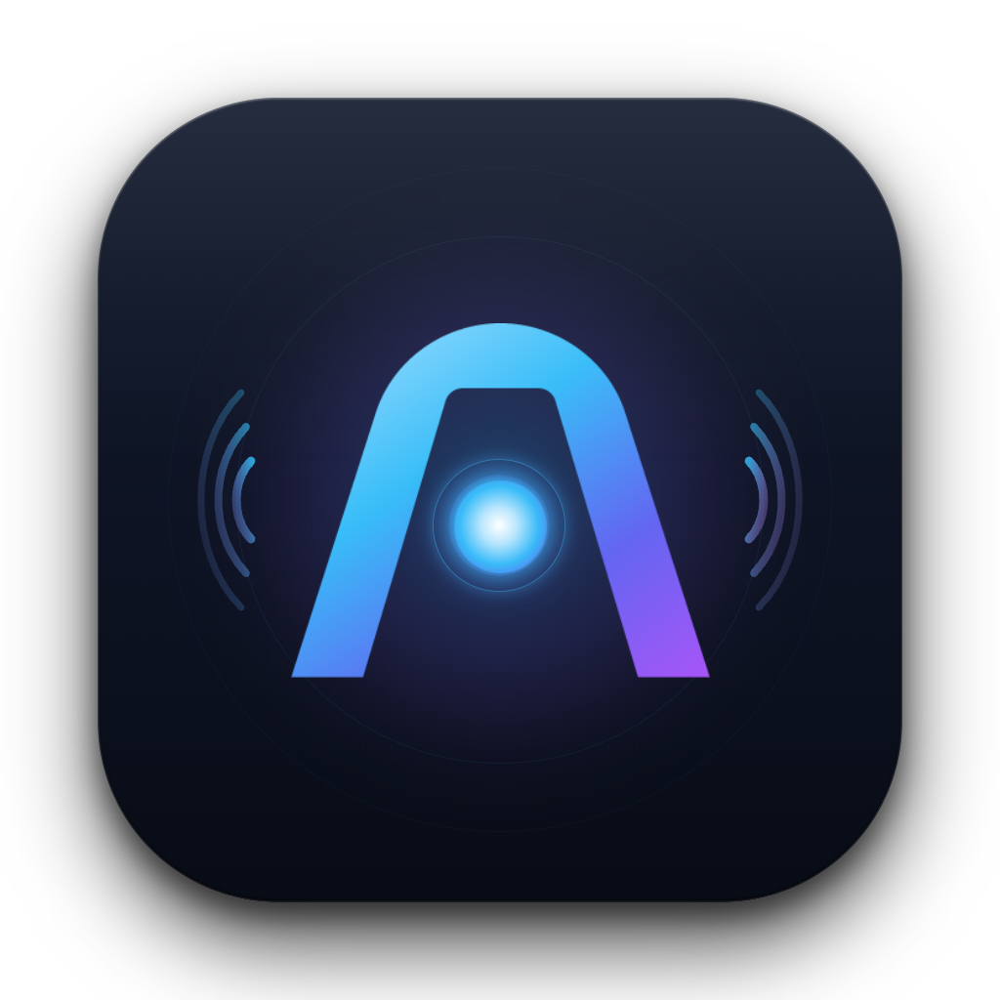

# 🎙️ Plaud Studio

<p align="center">
  
</p>

<p align="center">
  <strong>Local-First, Privacy-Centric Desktop Studio for Plaud Devices</strong><br />
  High-Speed Metal Transcription • Neural Speaker Diarization • KaTeX Scientific Equations • AI Lesson Notes & Meeting Minutes
</p>

<p align="center">
  
  
  
  
  
</p>

---

## 🌟 Overview

**Plaud Studio** is an all-in-one companion application designed for users of **Plaud Note** and **Plaud NotePin** voice recorders. It gives you complete local ownership of your voice data by synchronizing recordings from your Plaud account, converting and transcribing audio with Apple Silicon Metal acceleration, labeling speakers via neural diarization, and generating deep structured **Lesson Notes** (for university lectures) and **Meeting Minutes** (for team discussions).

All audio playback is synchronized to millisecond-accurate transcripts with click-to-seek playback, LaTeX math rendering, and one-click offline HTML export.

---

## ✨ Key Features

### ⚡ 1. High-Speed On-Device Speech Pipeline
- **Metal GPU Transcription**: Powered by `whisper.cpp` (`whisper-cli`) running **Whisper Large v3 Turbo** with Flash Attention on Apple Silicon GPU (~100x real-time speed).
- **Phantom Line & Hallucination Suppression**: Built-in repetition filtering and temperature fallbacks eliminate whisper hallucinations during dead air and silent audio pauses.
- **Neural Speaker Diarization**: Identifies multiple speakers using **NVIDIA Nemotron-3 (Sortformer v3)** executed in an isolated, dependency-managed `uv` Python environment.
- **On-Device Models Manager**: Direct in-app manager (`Settings > On-Device Models`) to download models from Hugging Face or instantly link local system weights into `~/Library/Application Support/Plaud Studio/models/`.

### ☁️ 2. Plaud Cloud Ingestion & Dedicated Cloud Notes
- **Direct Cloud Sync**: Automatically pulls down existing transcripts (`transaction` / `transaction_polish`) and AI summaries (`auto_sum_note`) from your Plaud Cloud account.
- **Dedicated "☁️ Plaud Summary" Tab**: View the original cloud summary in its own dedicated tab without overwriting or interfering with your local Studio Lesson Notes or Meeting Minutes.
- **Immediate Transcript Usability**: Cloud transcripts are normalized into millisecond-accurate segments with speaker tags, making remote recordings immediately readable and clickable even before downloading audio.
- **On-Demand "☁️ Pull Cloud Data"**: Refresh or retrieve remote transcripts and summaries for any specific recording at any time from the reader header.

### 🎧 3. Smart Decoupled Audio & Interactive Player
- **Independent Local Audio Tracking**: Decouples audio file storage from notes and transcript availability. Recordings with cloud summaries but without downloaded audio clearly show `☁️ Cloud Audio` and a `⬇️ Download` action.
- **Dynamic Action Switching**: Cards show `⬇️ Download` while audio resides in the cloud, and seamlessly transform into `▶ Play` as soon as the audio is saved to your Mac.
- **Click-to-Seek Synchronization**: Clicking any timestamp (`[04:12]`) in the transcript immediately jumps the custom audio player to that exact millisecond. If audio is still in the cloud, clicking to seek prompts an instant one-click download.
- **Live Spoken Highlighting**: Highlights the currently active sentence/paragraph as the recording plays.
- **Playback Controls**: Variable speed (0.75x, 1x, 1.25x, 1.5x, 2x), 15-second skip forward/back, and scrubber bar with buffered audio streaming.
- **Non-Destructive Titles**: Rename recordings at will—Plaud Studio preserves your custom title while tracking the original hardware file title.
- **Folder Organization**: Automatically mirrors folders from your Plaud Cloud account (e.g., `CHEM 131`, `Project Alpha`).
- **Offline HTML Export**: Export self-contained single-file HTML reports complete with dark/light theme support, KaTeX math, audio metadata, print-to-PDF styles, and both Studio & Plaud Cloud summaries.

### 🧠 4. Local AI Summaries: Lectures & Work Meetings
- **🎓 University Lectures**:
  - Executive Overview & Learning Objectives
  - Core Academic Glossary (Markdown tables with terms, academic significance, and context)
  - Detailed Chronological Lesson Notes with deep conceptual explanations
  - Scientific Equations, Stoichiometric Formulas, and Step-by-Step Problem Solving
  - Active Recall & Self-Test Questions for exam preparation
- **💼 Work Meetings**:
  - Executive Summary & High-Level Context
  - Key Decisions & Strategic Agreements
  - Detailed Topic-by-Topic Discussion Log
  - Action Items Table (Assignee, Task, Deadline, Context)
  - Open Questions, Blockers & Follow-Up Steps
- **Multi-Engine AI Backend**:
  - **Local llama.cpp (Default)**: Fully private inference using local GGUF weights (Qwen 2.5, Llama 3, Mistral, etc.) on Metal GPU.
  - **Google Gemini API**: Native integration with Gemini 2.5 Flash / Pro.
  - **OpenAI-Compatible**: Connect to Ollama, Groq, OpenRouter, or OpenAI endpoints.

### 📐 5. Scientific Notation & KaTeX Equation Rendering
- **Full Offline KaTeX Engine**: Embedded directly in the application bundle—no internet required.
- **Equations & Reactions**: Parses both inline expressions (`$E = mc^2$`) and display blocks (`$$\text{Moles} = \frac{\text{Mass}}{\text{Molar Mass}}$$`), including chemistry arrows (`\xrightarrow{}`), matrices, and Greek symbols.
- **Print & Export Fidelity**: Equations render in both the interactive desktop reader and standalone HTML exports.

### 🖥️ 6. Native macOS Desktop App & Real-Time HUD
- **Packaged App**: Runs as a first-class macOS citizen in `/Applications/Plaud Studio.app` with native menu bar controls and Dock icon.
- **Activity HUD & Live Logs Drawer**: Real-time status badge ("Downloading", "Converting", "Transcribing", "Summarizing") and a slide-out live server log stream via Server-Sent Events (SSE).
- **Hot-Reload Dev Mode**: Automatic UI hot-reloading and backend server restarting when editing files in development.

---

## 🛠️ Requirements

- **Operating System**: macOS 13+ (Apple Silicon M1/M2/M3/M4 recommended)
- **Node.js**: v20 or later
- **CLI Tools**:
  - `ffmpeg` (for audio demuxing and 16kHz WAV conversion): `brew install ffmpeg`
  - `whisper-cli` (whisper.cpp): `brew install whisper-cpp`
  - `uv` (fast Python package runner for speaker diarization): `brew install uv`
- **Plaud Account**:
  - Active Plaud account (`~/.plaud/tokens-mcp.json` or web credentials)

---

## 🚀 Quick Start

### 1. Installation

```bash
git clone <repo-url> plaud-studio
cd plaud-studio
npm install
```

### 2. Launching Plaud Studio

To run the desktop application with live hot-reloading:

```bash
npm run dev
```

To run only the backend server (accessible at `http://localhost:3300` in your web browser):

```bash
npm start
```

### 3. Install to macOS Applications Folder

To package and install Plaud Studio directly into `/Applications`:

```bash
npm run install:app
```

You can now launch **Plaud Studio** from macOS Spotlight, Launchpad, or Finder!

---

## 🧠 Model Setup

Plaud Studio stores all speech and diarization models locally in your macOS Application Support directory:

```
~/Library/Application Support/Plaud Studio/models/
```

| Model | Purpose | Default File | Size |
| :--- | :--- | :--- | :--- |
| **Whisper Large v3 Turbo** | Speech-to-Text (ASR) | `ggml-large-v3-turbo.bin` | ~1.51 GB |
| **NVIDIA Nemotron-3** | Neural Speaker Diarization | `nemotron3_diar_v3.onnx` | ~382 MB |

> [!TIP]
> You can download or import these models automatically by opening **Settings ⚙️ ➔ On-Device Models** inside the app. If you have Meetily installed, Plaud Studio will detect existing model files and let you copy them instantly without re-downloading.

---

## 📂 Project Architecture

```
plaud/
├── assets/                  # Brand assets & native app icons (.icns, .png)
│   ├── emblem.png           # Plaud emblem source vector graphic
│   ├── icon.icns            # macOS multi-resolution icon bundle
│   └── icon.png             # 1024x1024 master icon
├── electron/                # Electron desktop wrapper
│   ├── main.js              # Native window, menus, dev watchers & lifecycle
│   └── preload.cjs          # Context isolation bridge
├── public/                  # Frontend single-page application
│   ├── index.html           # Main dashboard, reader modal, settings modal & HUD
│   ├── app.js               # Reactive state, audio-transcript sync, SSE logger
│   ├── styles.css           # Modern dark/light typography and layout
│   ├── favicon.png          # Browser favicon
│   └── vendor/              # Bundled offline assets (KaTeX JS & CSS)
├── scripts/                 # Automation & build scripts
│   ├── brand-dev-electron.cjs # In-place dev binary bundle brander
│   └── generate-icon.cjs    # High-resolution native icon generator
├── src/                     # Backend application code
│   ├── config.js            # Environment resolution & system path guarantees
│   ├── db.js                # SQLite storage using node:sqlite with WAL mode
│   ├── diarize.py           # NVIDIA Nemotron-3 Sortformer v3 runner
│   ├── logger.js            # Centralized logging & SSE live stream hub
│   ├── models.js            # On-device model catalog, downloads & verification
│   ├── plaud.js             # Plaud Cloud API client, OAuth token refresh & S3 audio
│   ├── server.js            # Express API, range-buffered audio streaming & HTML export
│   ├── summarize.js         # Multi-engine prompt builder, KaTeX parser & LLM client
│   └── transcribe.js        # ffmpeg audio converter & whisper-cli runner
└── package.json             # NPM package & electron-builder packaging config
```

### 📂 Unified Application Storage

All user data, recordings, transcripts, and model weights are kept in standard macOS Application Support:

```
~/Library/Application Support/Plaud Studio/
├── data/
│   ├── plaud_app.db         # Local SQLite database (WAL mode)
│   ├── audio/               # Downloaded audio recordings (.ogg)
│   └── tmp/                 # Conversion scratch files
└── models/                  # Speech & diarization models (Whisper, Nemotron)
```

---

## ⌨️ Common Scripts

| Command | Action |
| :--- | :--- |
| `npm run dev` | Brands dev Electron binary and launches desktop app with file watching |
| `npm start` | Runs backend Express server on port 3300 |
| `npm run build:icon` | Generates 1024px PNG and multi-resolution `.icns` bundle from vector source |
| `npm run package:mac` | Packages the application directory into `dist/mac-arm64/` using `electron-builder` |
| `npm run install:app` | Builds macOS arm64 app and installs directly to `/Applications/Plaud Studio.app` |
| `npm run dist:mac` | Builds standalone distribution `.dmg` and `.zip` installer files in `dist/` |

---

## 🔒 Privacy & Local Ownership

- **100% Offline Capable**: Once audio is downloaded from Plaud Cloud, transcription (Whisper), speaker diarization (Nemotron-3), and summarization (when using local llama.cpp) run entirely on your local machine with zero external network requests.
- **Safe Database**: Recordings, transcripts, custom titles, and notes reside in a standard local SQLite database (`~/Library/Application Support/Plaud Studio/data/plaud_app.db`).
- **Self-Contained Exports**: Standalone HTML exports are fully portable and include embedded CSS, KaTeX math formatting, and offline-compatible styles.

---

## 📄 License

MIT License. See [LICENSE](LICENSE) for details.
